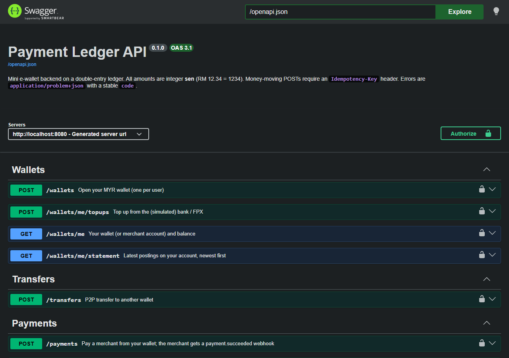
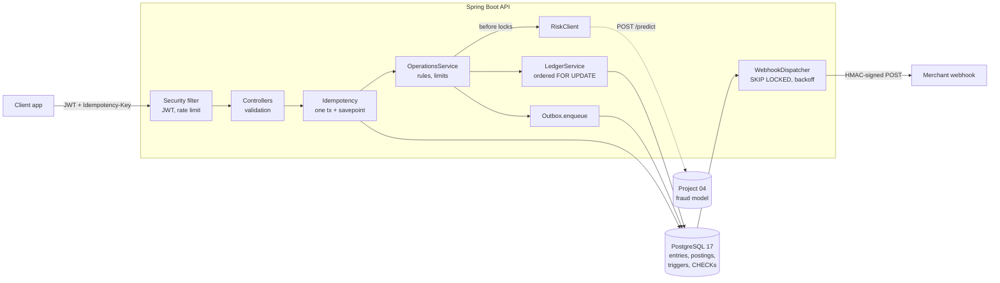

# Payment Ledger API

**A mini e-wallet backend (Java 25 + Spring Boot 4 + PostgreSQL) built on a double-entry ledger, proven correct under
100 parallel transfers, duplicate retries and randomized operation sequences.**



[](https://github.com/zeeqy/payment-ledger-api/actions/workflows/ci.yml)

## Problem

An e-wallet (think Touch 'n Go eWallet, Boost, GrabPay) moves money between users and merchants all day. If two taps
on "Pay" at the same moment both go through, or a phone retries after a timeout and charges twice, real people lose
real ringgit. This project is the backend part that has to be right: the ledger, the money-moving endpoints, and the
proof that they stay right under concurrency and retries.

## What it does

- **Double-entry ledger.** Every movement is a journal entry whose postings sum to zero; balances are derived from
  postings. Postgres itself refuses unbalanced entries, overdrafts and edits (constraint triggers + `CHECK`).
- **Operations.** Open wallet, top-up (simulated FPX), P2P transfer, merchant payment, partial refunds (never more than
  paid), operator reversal (mirror entry, original untouched).
- **Idempotency keys** on every money-moving POST: same key, same response bytes, money moves once, even when the 5
  retries arrive in parallel.
- **Concurrency safety:** row locks taken in a fixed order (no deadlocks), money as `bigint` sen, decimals rejected.
- **JWT auth** (USER / MERCHANT / ADMIN), **per-user rate limiting**, request validation, **one error format**
  (`application/problem+json` + stable `code`, see [docs/ERRORS.md](docs/ERRORS.md)).
- **Merchant webhooks** via a transactional outbox: HMAC-SHA256 signed, exponential backoff with jitter, dead-letter.
- **Audit log**, **daily transfer limit** (Malaysian calendar day), optional **fraud check** that calls project 04's
  [`/predict`](https://github.com/zeeqy/fraud-detection-api).
- **OpenAPI docs** at `/docs`; **reconciliation** endpoint that recomputes every invariant from raw postings.

## Proof

| Claim | Test | Result |
|---|---|---|
| No overdraft under contention | 100 parallel RM 1.50 transfers from a RM 100 wallet over HTTP (`ConcurrencyTest`) | exactly 66 succeed, 34 `INSUFFICIENT_FUNDS`, final balance RM 1.00, 0 errors |
| No deadlocks | 100 simultaneous A->B and B->A transfers | all 100 succeed |
| Exactly-once with retries | same `Idempotency-Key` sent 5 times **in parallel** | 1 posting, 5 identical bodies, 4 marked `Idempotent-Replayed: true` |
| Refunds capped | 20 parallel RM 3 refunds of a RM 10 payment | exactly 3 succeed |
| Sum of postings is always 0 | model-based property test: 20 seeds x 80 random top-ups/transfers/payments/refunds/reversals (`LedgerPropertyTest`) | after every step: sum = 0, every balance = its postings = the model, nothing overdrawn |
| DB guards work without the app | `SchemaGuardsTest` writes bad postings directly | unbalanced, overdraft, `UPDATE`/`DELETE` all rejected |

**Load (k6, one laptop, details and caveats in [load/RESULTS.md](load/RESULTS.md)):**

| Rate (60% transfers, 30% reads, 10% payments) | Transfer p95 | Payment p95 | Errors |
|---|---|---|---|
| 400 req/s | 33 ms | 63 ms | 0% |
| **600 req/s** | **69 ms** | **157 ms** | **0%** |
| 800 req/s requested | saturates at ~677 req/s, p95 ~1 s | | 0% |

Payments are slower because they all lock the same merchant row: the "hot account" problem, discussed in
[docs/DESIGN.md](docs/DESIGN.md#what-breaks-first-at-scale).

## Architecture



Why each piece is the way it is: [docs/DESIGN.md](docs/DESIGN.md).

## Stack

Java 25, Spring Boot 4.1 (Web MVC on virtual threads, Security, OAuth2 resource server for JWT), Spring JDBC
(`JdbcClient`, plain SQL), Flyway, PostgreSQL 17, Bucket4j, springdoc-openapi, JUnit 5 + Testcontainers + Awaitility,
k6, Docker Compose, GitHub Actions, Spotless (Palantir format).

## How to run

Needs Docker and JDK 25 (or only Docker for the all-in-container option).

```bash
# Option A: everything in Docker (API on :8080, Postgres on :55433)
docker compose --profile app up -d --build
# open http://localhost:8080/docs   (admin: admin@ledger.local / admin-dev-password, dev only)

# Option B: Postgres in Docker, API from source
docker compose up -d db
./mvnw spring-boot:run      # Windows: mvnw.cmd spring-boot:run
```

Try it (or use the Authorize button in `/docs`):

```bash
TOKEN=$(curl -s -X POST localhost:8080/auth/register -H 'Content-Type: application/json' \
  -d '{"email":"ali@example.my","password":"a-long-password"}' | jq -r .accessToken)
curl -s -X POST localhost:8080/wallets -H "Authorization: Bearer $TOKEN"
curl -s -X POST localhost:8080/wallets/me/topups -H "Authorization: Bearer $TOKEN" \
  -H 'Content-Type: application/json' -H 'Idempotency-Key: topup-001' -d '{"amountSen": 5000}'
```

**Tests** (starts its own Postgres with Testcontainers, about 2 min, 61 tests):

```bash
./mvnw verify
```

**Load test** (k6 inside the Compose network):

```bash
RATE_LIMIT_PER_MINUTE=1000000 docker compose --profile app up -d --build
RATE=600 DURATION=60s docker compose --profile app --profile load run --rm --no-deps k6
```

**Fraud check** (optional): run project 04's API and start this one with `RISK_URL=http://host:8000`.

Config is all environment variables; see [.env.example](.env.example).

## Limitations

- Not a real payment system: top-ups are simulated, no withdrawals to bank, single currency (MYR), no KYC tiers.
- Load numbers come from one laptop with k6, API and DB on the same machine; they show relative behaviour, not
  production capacity.
- The property test is home-made (seeded random sequences + an in-memory model), not a framework with shrinking.
- Rate limits live in memory (per instance); webhooks are polled from the DB. Both have known scale fixes in
  [DESIGN.md](docs/DESIGN.md).
- The fraud model (project 04) was trained on PaySim, whose amounts aren't MYR, so its score here is a demo signal.
- No live demo: a free-tier host would sleep and lose the database; everything runs locally with one command.
