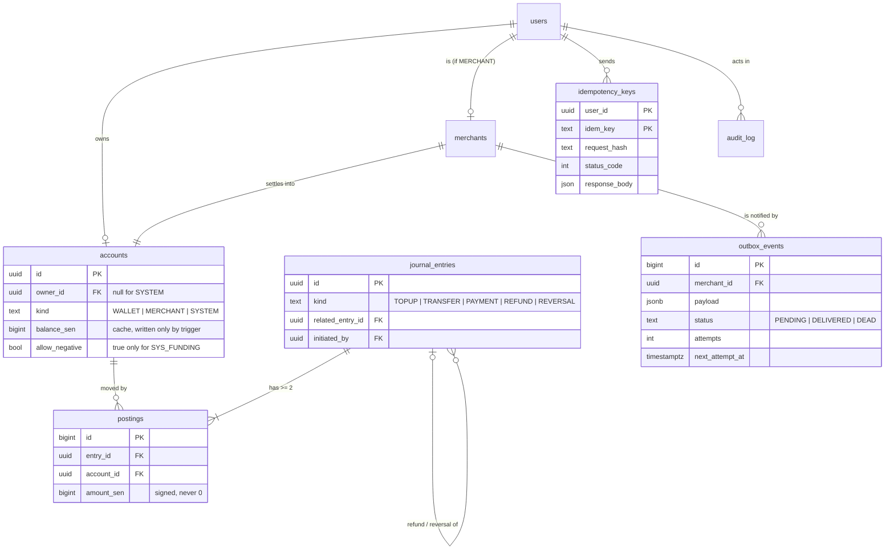

# Design

## Schema



## Why double entry

A single `balance` column that gets `+=` and `-=` can't explain itself: if it's wrong, nothing tells you why. In double
entry every movement is a **journal entry** made of **postings** that sum to zero. Money is never created or destroyed,
only moved between accounts, so:

- The sum of *all* postings is always 0. A non-zero sum is a bug you can detect with one query.
- Every balance is the sum of that account's postings, so any balance can be recomputed and audited.
- Nothing is edited or deleted. A mistake is fixed by a new **reversal** entry, which keeps history intact.

Where does top-up money come from? From `SYS_FUNDING`, a system account standing for the bank/FPX settlement account.
It's the only account allowed to go negative: its balance is minus the total e-money in circulation.

**Enforced by the database, not just the code:**

| Rule | How |
|---|---|
| Entry sums to zero, has >= 2 postings | `DEFERRABLE INITIALLY DEFERRED` constraint trigger, checked at `COMMIT` |
| No overdraft | `CHECK (allow_negative OR balance_sen >= 0)` on `accounts` |
| Balance = sum of postings | `AFTER INSERT` trigger on `postings` updates `accounts.balance_sen`; app never writes it |
| Append-only | `BEFORE UPDATE OR DELETE` triggers raise on `postings` and `journal_entries` |
| Reverse at most once | Partial unique index on `related_entry_id WHERE kind = 'REVERSAL'` |
| Integer money | `bigint` sen everywhere; JSON parser rejects `12.5` instead of truncating it |

`balance_sen` is a cache so reading a balance is O(1) instead of summing every posting. `GET /admin/reconciliation`
recomputes everything from raw postings and reports any drift.

## Concurrency

Each operation is one transaction: **lock accounts -> check rules -> insert entry + postings -> audit -> outbox**.

- Locks are `SELECT ... FOR UPDATE` on the account rows, taken **in ascending id order**. Two opposing transfers
  (A->B and B->A) therefore always ask for the same first lock, so they queue instead of deadlocking. Tested by
  `ConcurrencyTest.opposingTransfersDoNotDeadlock`.
- The funds check and the daily-limit check run **after** the lock, on a value no one else can change until commit. So
  100 parallel RM 1.50 transfers from a RM 100 wallet give exactly 66 successes and 34 `INSUFFICIENT_FUNDS`.
- Why row locks and not `SERIALIZABLE`: serializable would also be correct, but it aborts conflicting transactions and
  the client must retry them. Row locks make conflicting requests wait instead, which is simpler to reason about and
  needs no retry loop. The cost is that one hot account is a serial bottleneck (see below).
- The fraud model call happens **before** taking locks so a slow model never holds a wallet locked.

## Idempotency

Clients send `Idempotency-Key` on every money-moving POST. Keys are scoped per user.

```mermaid
sequenceDiagram
    participant C as Client
    participant A as API
    participant DB as Postgres
    C->>A: POST /transfers (key K)
    A->>DB: BEGIN; INSERT key K ON CONFLICT DO NOTHING
    alt inserted (first time)
        A->>DB: SAVEPOINT; lock, post entry, audit, outbox
        alt business error (e.g. insufficient funds)
            A->>DB: ROLLBACK TO SAVEPOINT
        end
        A->>DB: UPDATE key K SET status, response; COMMIT
        A-->>C: 201 (or 4xx), Idempotent-Replayed: false
    else conflict (seen before / in flight)
        Note over A,DB: If K's first request is still running, the INSERT waits for its COMMIT
        A->>DB: SELECT stored status + body (check request hash)
        A-->>C: same status + same bytes, Idempotent-Replayed: true
    end
```

- The key row and the money movement **commit together**. There's no window where money moved but the key wasn't
  saved, or the other way round.
- A request hash (method + path + body) catches a client reusing a key for a different request -> 422.
- The stored response is `json` (not `jsonb`) because `jsonb` reorders keys and the replay must be byte-identical.
- 5xx/crashes roll back the whole transaction, key included, so a retry runs normally.
- Tested with 5 identical requests fired in parallel: 1 posting, 5 identical bodies, 4 marked replayed.

## Webhooks: transactional outbox

Calling the merchant's URL inside the payment transaction is wrong in both directions: if the HTTP call succeeds and
the DB commit then fails, the merchant ships goods for a payment that doesn't exist; if the commit succeeds and the
call fails, the merchant never hears about a real payment.

So the payment transaction only **inserts an `outbox_events` row**. A scheduled dispatcher delivers it later:

1. **Claim:** `UPDATE ... WHERE id IN (SELECT ... FOR UPDATE SKIP LOCKED LIMIT 20)` bumps `attempts` and leases the rows
   for 60 s. `SKIP LOCKED` lets several API instances dispatch without sending the same event twice at the same time.
2. **Send** outside any transaction (no DB connection held during HTTP), 3 s connect / 5 s read timeout, signed:
   `Ledger-Signature: t=<unix>,v1=<hex HMAC-SHA256(secret, t + "." + body)>`. Signing the timestamp lets the merchant
   reject replays; `WebhookSigner.verify` is the reference check (constant-time compare).
3. **Result:** 2xx -> `DELIVERED`. Otherwise retry after `base * 2^(attempt-1)` (+ up to 10% jitter, capped at 1 h).
   After 8 attempts -> `DEAD`, kept for manual replay.

Delivery is **at least once**: if we crash after the merchant's 200 but before marking it delivered, it's sent again.
Every event has a stable `id` so merchants deduplicate.

## Other pieces

- **Auth:** stateless HS256 JWT (`sub` = user id, `role` = USER | MERCHANT | ADMIN), BCrypt passwords, login takes the
  same time for unknown emails. HS256 is fine for one service; several services would want RS256 + JWKS.
- **Rate limit:** Bucket4j token bucket per user id (per IP before login), 120/min default, `429` + `Retry-After`.
- **Limits:** per-transaction cap and a daily outgoing cap per wallet over the Malaysian calendar day
  (`Asia/Kuala_Lumpur`), counted from postings under the wallet lock.
- **Risk hook:** optional `POST {RISK_URL}/predict` to project 04 (fraud-detection-api). `flag` -> 422
  `RISK_DECLINED`. Timeout/error -> allowed by default (`RISK_FAIL_OPEN=true`) and audited, because blocking all
  payments when a model is down is usually worse for an e-wallet than a short window of unscreened transfers.
- **Audit log:** every action, written in the same transaction. Refused risk decisions are written in a separate
  transaction (`REQUIRES_NEW`) so they survive the rollback of the refused operation.

## What breaks first at scale

Measured: ~600 req/s sustained on one laptop, ceiling ~680 req/s ([load/RESULTS.md](../load/RESULTS.md)).

1. **Hot accounts.** Every payment to one merchant locks that merchant's row, so payments to a popular merchant are
   serial; the load test already shows payment p95 at 2x transfer p95. Fixes: split the merchant into N sub-accounts
   and pick one at random (sum them for the balance), or credit merchants asynchronously from a queue in batches.
   `SYS_FUNDING` has the same problem for top-ups.
2. **Single Postgres.** All writes go to one primary. Next steps: connection pooling (PgBouncer), read replicas for
   statements, then partitioning `postings` by month; beyond that, shard by account id (which makes cross-shard
   transfers a distributed-transaction problem, the reason real ledgers like TigerBeetle exist).
3. **Growing tables.** `postings`, `audit_log`, `idempotency_keys` grow forever. Partition by time; expire idempotency
   keys after e.g. 24 h; snapshot balances so reconciliation doesn't scan all history.
4. **In-memory rate limits** are per instance: with N instances the real limit is N x 120. Move buckets to Redis.
5. **Outbox polling** every second is fine for thousands of events/min; past that, use logical replication / CDC
   (Debezium) into Kafka instead of polling.
6. **Daily-limit query** sums today's postings for the wallet on every transfer; heavy users would want a per-day
   counter row updated under the same lock.

## Deliberate simplifications

- One currency (MYR). Multi-currency needs per-currency accounts and FX entries.
- Top-ups are simulated (no real FPX/card integration); there are no withdrawals to bank.
- No KYC tiers. A real Malaysian e-money issuer would have different wallet and transaction limits per verification
  level, set by its BNM approval; here they're just configuration.
- Refunds can't be reversed, and a payment with refunds can't be reversed, to keep the refund arithmetic simple.
